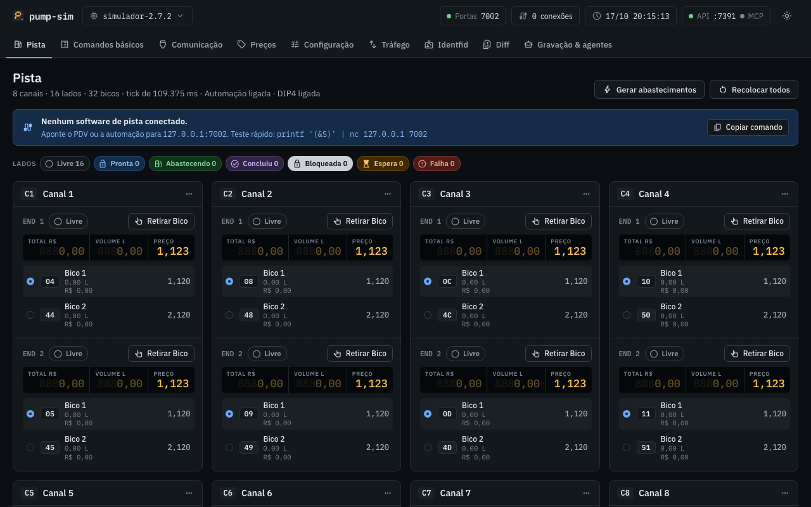

# pump-sim

Open-source simulator of Companytec fuel concentrators, faithful to the protocol and to SimuladorCBC 2.7.2.

[](https://github.com/gmartinu/pump-sim/actions/workflows/ci.yml)
[](#parity-with-simuladorcbc-272)
[](https://github.com/gmartinu/pump-sim/releases/latest)
[](https://www.npmjs.com/package/pump-sim)
[](https://www.npmjs.com/package/pump-sim#provenance)
[](LICENSE)
[](package.json)
[](https://gmartinu.github.io/pump-sim/)



## Quickstart

macOS / Linux (Node 22+), no install:

```sh
npx pump-sim --profile simulador-2.7.2 --ui
```

Windows: download `pump-sim-win-x64.exe` (with its `.sha256`) from the
[latest GitHub release](https://github.com/gmartinu/pump-sim/releases/latest) and double-click it;
no Node needed.

From source (to work on the code):

```sh
git clone https://github.com/gmartinu/pump-sim && cd pump-sim
npm install && npm run build && npm link
pump-sim --profile simulador-2.7.2 --ui
```

## About

Open-source simulator of Companytec fuel concentrators (CBC01–CBC06, Horustech, Concept).
It speaks the protocol like **SimuladorCBC 2.7.2** and like the real consoles (DT435/DT432),
and is meant for testing any forecourt software. It does not depend on any POS.

- Node 22+, strict TypeScript, no native dependency (Mac, Windows, CI).
- The core (`src/core`) knows nothing about protocols. The codecs live in `src/protocols`.
- Profiles (`src/profiles`) are data: `simulador-2.7.2`, `cbc-32`, `cbc05-dip3`, `cbc01`,
  `horustech-cbc-36`, `horustech-48`, `concept-48`.
- The 2.7.2 bugs are *quirks*, on by default only in the `simulador-2.7.2` profile.
- The clock is injectable (`ManualClock` in tests), so everything is deterministic.

Not affiliated with or endorsed by Companytec. MIT license ([LICENSE](LICENSE)).

Current state: Companytec `(&…)`, Identfid `(?…)` with the 14 identification modes, and native
Horustech `>?` only for functions 02/06/32 (the ones the 2.7.2 handles). TCP server with the
profile's ports: 2001/1771/857 at the same time, with a pointer per port, on the real consoles;
one port at a time (2001/1771/7002) and a single pointer on `simulador-2.7.2`.

## Profiles

| Profile | Console | Reference | Validation |
| --- | --- | --- | --- |
| `simulador-2.7.2` | SimuladorCBC 2.7.2 (CBC-06, 8 channels, single pointer) | SimuladorCBC 2.7.2 | measured against the real SimuladorCBC 2.7.2 |
| `cbc-32` | CBC06, `&S` 32 positions + trailer | DT435 | per the manual, not validated on hardware |
| `cbc05-dip3` | CBC03/04/05, `&A` 52 or 34 by DIP3 | DT435 p.3-4 | per the manual, not validated on hardware |
| `cbc01` | CBC01 / IMS01-02, serial only | DT435 p.4 | per the manual, not validated on hardware |
| `horustech-cbc-36` | Horustech in CBC protocol, 36 positions, 9 channels | DT435 p.22 | per the manual, not validated on hardware |
| `horustech-48` | Horustech in Companytec protocol, 48 positions, 12 channels | DT435 p.22, DT277 p.7 | per the manual, not validated on hardware |
| `concept-48` | Concept (= `horustech-48`) | DT432 p.4 | per the manual, not validated on hardware |

## Running

```sh
pump-sim --profile simulador-2.7.2                 # listens on 2001 (or --ports 1771 | 7002)
pump-sim --profile horustech-48                    # 2001, 1771 and 857 at the same time
pump-sim --profile cbc-32 --ports 2001,1771 --control 7070 --record trafego.jsonl
pump-sim mcp --control http://127.0.0.1:7070       # stdio MCP server
pump-sim --listar-perfis
```

(`pump-sim` = `npx pump-sim`, or `node dist/cli.js` from source.) Quick test: `printf '(&S)' | nc 127.0.0.1 2001`.
CLI logs go to stderr. `--relogio-manual` stops the clock: time only moves through the
`avancar_tempo` command, which makes a client's CI deterministic.

## Web UI (`--ui`)

```sh
pump-sim --profile simulador-2.7.2 --ui            # simulator on 2001, API + UI on 127.0.0.1:7070, opens a window
pump-sim --profile horustech-48 --ui --sem-abrir   # only prints "UI em http://127.0.0.1:7070/"
pump-sim --ui --lembrar                            # starts from the last profile/port/equipment and keeps saving it
```

The UI is served by the control API itself (`/`, `/ui/*`, same loopback rules) and drives the
simulator only through it: commands over the WS, a 300 ms poll of `get_estado_simulador`/`get_displays`
and the live `trafego`/`falha` events. Tabs: Pista (the 2.7.2 panels; compact grid for 12-channel
profiles), Comandos básicos, Comunicação, Preços, Configuração, Tráfego (console + fault injection),
Identfid, Diff, Gravação & agentes. No build step: the files in `ui/` are plain ES modules. Fonts and icons are bundled in `ui/fonts/`: the page loads nothing outside loopback.
`--gravacoes <pasta>` sets where the UI records (default `./gravacoes`). The Windows executable
(Node SEA) with no arguments behaves as `--ui --lembrar` (see below). Details: DECISIONS §19.

## Windows executable

One file, `pump-sim-win-x64.exe` (Node 22.20.0 single executable application with the UI inside):
double-click it and it starts as `--ui --lembrar` (simulator on 2001, UI on `http://127.0.0.1:7070/`
in an Edge app window, then Chrome, then the default browser; last configuration in
`%APPDATA%\pump-sim\ultima-config.json`). Any argument works as in the CLI
(`pump-sim-win-x64.exe --profile cbc-32 --ports 2001`). The console window is the simulator's log;
closing it stops the simulator.

Build it on any OS with Node **22.20.0** exactly (the SEA blob follows the Node version):

```bash
npm run build:sea:win                                   # → build/sea/pump-sim-win-x64.exe
npm run build:sea:win -- --cache <dir> --out <file.exe> # reuse a download folder / pick the output
```

It bundles `dist/cli.js` with esbuild into `build/sea/pump-sim.cjs`, lists every file of `ui/` as a SEA
asset, downloads `node-v22.20.0-win-x64.zip` from nodejs.org, checks its sha256 against
`SHASUMS256.txt` (stops on mismatch), removes `node.exe`'s Authenticode signature and injects the blob
with postject, then sets the pump-sim icon (`tools/icon/pump-sim.ico`) and version info with resedit
and reads the PE back to check them. The bundle also runs on its own: `node build/sea/pump-sim.cjs --ui`.
The raster icons come from `ui/icone.svg`; after changing it, run `node tools/gen-icons.mjs` (needs
Chrome) and commit the outputs.

**A local build is not signed.** On first run Windows SmartScreen shows "O Windows protegeu o
computador" ("Windows protected your PC"): click "Mais informações" ("More info") → "Executar assim
mesmo" ("Run anyway"). A file downloaded from a browser or chat may also need right-click →
Properties → "Desbloquear" ("Unblock"). Release builds are not code-signed yet either (see Code signing). Windows Firewall may ask about port 2001 (the simulator
listens on `0.0.0.0`; the UI and control API stay on loopback): allow private networks for a bench PDV
on another machine, or cancel for same-machine use.

### Releases

The npm package `pump-sim` is released only through the release workflow on a `v*` tag: CI stages
the version with `npm stage publish` over npm Trusted Publishing (no long-lived token, stage-only
permission) with a provenance attestation linking it to the commit and workflow run that built it,
and a maintainer approves it, with 2FA, in the Staged Packages tab on npmjs.com before it goes live.

### Code signing

Release executables are built by GitHub Actions from this repository only. **They are not
code-signed yet**: the SignPath Foundation application is pending, so Windows SmartScreen warns on
first run (see above) and each release says so in its notes; verify the download against its
`.sha256`. Once approved, releases will be signed through SignPath: free code signing provided by
[SignPath.io](https://about.signpath.io), certificate by [SignPath Foundation](https://signpath.org).
Roles, approval and privacy statement: [CODE_SIGNING.md](CODE_SIGNING.md). A new certificate may
still show a SmartScreen warning until it builds reputation.

## Control API (`--control <port>`)

HTTP + WebSocket on `127.0.0.1` (`--control-host` changes it). No framework (`node:http` + `ws`).

| Route | What |
| --- | --- |
| `GET /api/catalogo` | All commands, with group, description and JSON Schema of the arguments |
| `POST /api/comandos/<nome>` | Runs it; the body is the arguments JSON |
| `GET /api/comandos/<nome>?bico=04` | Shortcut, only for commands of the `leitura` group |
| `GET /api/estado` | `get_estado_simulador`: profile, quirks, ports, connections, timers, sides, nozzles, buffer, pointers, faults |
| `GET /api/sims` | Instances (`sim_id`) |
| `GET /api/servidor` | WS clients and the last calls from agents (MCP/HTTP/WS, with origin) |
| `GET /api/gravacoes/<nome>.jsonl` | Download of a recording in the recordings folder |
| `GET /`, `/ui/*` | The web UI |
| `WS /ws` | Pushes `log` (RX/TX/ERRO/INFO), `evento`, `conexao`, `perfil`, `reset`, `trafego` (socket reads/writes with the connection), `falha` (a fault fired); accepts `{id, comando, args}` and replies `{id, ok, resultado\|erro}` |

Reply: `{ "ok": true, "resultado": … }` or `{ "ok": false, "erro": "…" }` (400 argument,
404 nonexistent nozzle/instance, 409 state does not allow it).

Security: the API has no authentication and some commands write files (`start_recording`).
That is why it listens only on `127.0.0.1`, allows no CORS, refuses (403) a non-loopback
`Origin` (HTTP and WS) and a non-loopback `Host` (DNS rebinding), requires
`content-type: application/json` on `POST` (415) and only accepts `GET /api/comandos/<nome>` for
commands of the `leitura` group (405). Only change `--control-host` on a trusted network.

The catalog (`src/control/catalogo.ts`) is the full command inventory (K18–K26 included, DECISIONS §4). Groups:

- **leitura** (reads; no socket and no pointer changes): `get_status`, `get_visualizacao`,
  `get_abastecimento` (layouts a52/a34/a36/a67/dupla/paf1/paf2/a4/lr/lc/h02), `list_abastecimentos`,
  `get_ponteiros`, `get_encerrante`, `get_precos`, `get_config_bico`, `get_serie`,
  `get_ids_abastecimento`, `get_relogio`, `list_cartoes`, `get_cartao`, `list_cartoes_desconhecidos`,
  `get_lista_negra`, `list_eventos`, `get_sensores`, `get_bombas`, `get_equipamento`,
  `get_estado_simulador`, `get_log_comunicacao`, `list_conexoes` (K19), `get_displays` (K25), `list_gravacoes`, `list_roteiros_diff` …
- **protocolo** (the effect of the request, without a TCP client): `incrementar_ponteiro`, `set_ponteiro` (K18),
  `set_modo`, `set_preco`, `preset`, `preset_identificado`, `gravar_cartao`, `excluir_cartao`,
  `limpar_cartoes`, `lista_negra`, `set_relogio`, `configurar_endereco`, `configurar_bico` (K22),
  `configurar_sensor`, `gravar_encerrante`, `carregar_config_padrao`, `enviar_comando_cru`, `enviar_pela_porta`.
- **controle** (physical): `retirar_bico`, `recolocar_bico`, `alternar_bico`, `abastecer`,
  `gerar_abastecimentos`, `limpar_buffer`, `apresentar_cartao`, `set_falha_endereco`, `set_automacao`, `set_rede_ac`,
  `set_bateria`, `set_dip`, `set_velocidade`, `set_relogio_simulado`, `avancar_tempo`,
  `injetar_evento`/`ciclo_energia` (K21), `set_quirk`, `set_modelo`/`set_firmware` (K26).
- **infra**: `injetar_falha`, `limpar_falhas`, `desconectar`, `travar`/`liberar_travamento`,
  `configurar_travamento`, `set_perfil`, `abrir_porta`/`fechar_porta`, `gravar_inicio`/`gravar_fim`,
  `replay`/`replay_parar`, `snapshot_salvar`/`snapshot_carregar`, `reset`, `diff_executar`,
  `aguardar_estado`, `importar_simcnf`/`importar_log` (K20), `criar_sim`/`remover_sim`.

`bico` accepts `"04"` (BB code in hex), `{canal, endereco, posicao}` (position 1..4) or
`{numero}` (lane nozzle). Every command accepts `sim_id` (default `default`).

Faults (`injetar_falha`): `sem_resposta`, `atraso` (`ms`), `frame_corrompido`/`truncado` (`bytes`),
`checksum_errado`, `fragmentar` (`partes`, `ms`), `resposta_dupla`, `erro` (`codigo`: `?t`, `?b`…),
`desconectar` (`rst`|`fin`), `travamento` (modal MessageBox: `ms`, or without `ms` until
`liberar_travamento`; on `simulador-2.7.2` the frame that opened it gets no reply and the others
are still served, as in the 2.7.2 modal loop; on real profiles it freezes everything). They match by port and by frame prefix (`"&S"`, `"?A"`, `">?"`, `"*"`),
apply `vezes` times (default 1, or `"sempre"`) and with `probabilidade` (seeded PRNG). `param.aplicar:
false` keeps the frame from even reaching the simulator.

## MCP

`pump-sim mcp --control http://127.0.0.1:7070` starts a stdio MCP server that only adapts the API:
the tools are the catalog above, and each call becomes a `POST /api/comandos/<tool>`. Example
MCP client configuration:

```json
{ "mcpServers": { "pump-sim": { "command": "pump-sim", "args": ["mcp", "--control", "http://127.0.0.1:7070"] } } }
```

## Recording and replay

`--record arquivo.jsonl` (or `gravar_inicio`) records all raw traffic. One line per event:

```json
{"ts":1792204202055,"porta":0,"conexao":0,"dir":"meta","bytes":"","meta":{"formato":"pump-sim/trafego@1","perfil":"cbc-32"}}
{"ts":1792204202733,"porta":2001,"conexao":1,"dir":"abre","bytes":""}
{"ts":1792204202733,"porta":2001,"conexao":1,"dir":"rx","bytes":"28265329","texto":"(&S)"}
```

| Field | Meaning |
| --- | --- |
| `ts` | ms since the Unix epoch, from the simulator clock |
| `porta` | console logical port (2001, 1771, 857, 7002); `0` on the `meta` line |
| `conexao` | connection id within the process (links abre/rx/tx/fecha) |
| `dir` | `rx` client → simulator (one socket read, not a frame), `tx` simulator → client (one `write`), `abre`, `fecha`, `meta` |
| `bytes` | the raw bytes in lowercase hex |
| `texto` | the same bytes in latin1, for reading only (optional; replay ignores it) |

Replay:

```sh
pump-sim replay servidor trafego.jsonl [--velocidade 1] [--mapa 2001=3001]   # plays the recorded concentrator
pump-sim replay cliente  trafego.jsonl --alvo 127.0.0.1:2001                  # sends the rx and compares with the tx
```

The server matches per frame using the recorded profile's framing (`meta.enquadramento`, or the Q1
of `meta.perfil`): `fluxo` on real profiles (reassembles fragments) and `leituraUnica` on the 2.7.2 (each
read is one command); `--enquadramento` forces it. It returns the `tx` that followed the same frame
in the recording, in order; a frame never seen = silence. The client opens one connection per recorded
connection and lists the byte-by-byte divergences (non-zero exit if there are any).

## Differential test

```sh
pump-sim diff --listar
pump-sim diff --a 127.0.0.1:2001 --controle-a http://127.0.0.1:7071 \
              --b 127.0.0.1:7002 --controle-b http://127.0.0.1:7070 --casos DIFF-05,DIFF-07
pump-sim diff --a 192.0.2.10:2001 --b 127.0.0.1:2001 --casos DIFF-03,DIFF-09 --interativo --json rel.json
```

The script (`src/diff/roteiros.ts`) holds cases DIFF-01..20 and DIFF-30,
`BANCADA-1710` and the `EQUIV-*` cases. Each case runs whole on target A and then on B, with new
connections, and every reply is compared byte by byte. Steps:

- `acao` (`src/diff/acoes.ts`): a click on the 2.7.2 UI (`canal`, `aba`, `bico_radio`,
  `retirar`, `recolocar`, `abastecer`, `dip`, `velocidade`, `modelo`, `automacao`, `porta`,
  `config_padrao`, `fechar_modais`). On a target with a driver (`--controle-a`, the
  [bench driver](tools/driver-simuladorcbc/README.md)) it becomes `POST /acao`; on a target with the
  pump-sim API (`--controle-b`) it becomes the equivalent commands (the panel button with the
  driver's semantics: idempotent by caption, waits up to 4 s for "Abastecendo.."/"Aguarda
  liberação" or the rest captions); with neither, `--interativo` asks the operator, or the step is
  skipped and listed.
- `manual`: what the driver does not cover (IDF/card through the UI) and pump-sim-only commands
  (`soPumpSim`, e.g. holding the modal); against the driver it is skipped with the reason.
- `drenar`: `(&A)`/`(&I)` until `(0)` (the `(&A)` ends on its `)`, the silent `(&I)` waits 50 ms) at the start of each case (except `BANCADA-1710`, which assumes a
  freshly opened target), to clear records from earlier rounds.

How long each reply is listened for ([docs/DECISIONS.md §25](docs/DECISIONS.md#25-diff-wall-time-1710)):
a reply ends as soon as its protocol frame is complete (the closing `)` of Companytec/Identfid, the
length of a Horustech `>!` reply); only `&R` (several groups), a send with two frames and a fragmented
send keep the 150 ms idle tail. A step the bench recorded as silent (`silencio`, or `esperado: null`)
waits `--timeout-silencio` (400 ms) instead of `--timeout` (1 s), unless it sets its own `timeoutMs`
or a `fechar_modais` follows it. Bytes that arrive after a reply was declared complete are reported on
the next step as `atrasados`, never dropped in silence.

The `&S` battery byte is masked (it changes every tick on the 2.7.2), and so are the fields only the
clock writes (`mascara` on a step: record duration and hh:mm, the `&R` time, and the KK over them);
nothing else is masked. A failing action shows up in the report without stopping the diff.
Cases normalize the state they read (`configPadrao`, totalizers zeroed with `&E`, the clock set with
`&KW`, R$ presets so fueling volumes are the same on both targets), but `BANCADA-1710` (the first case)
and the empty-position steps of DIFF-08 need freshly opened targets: restart the 2.7.2 and pump-sim
before a full run. Triage of the first full run: [docs/DECISIONS.md §20](docs/DECISIONS.md#20-diff-r4b-triage-1710). DIFF-17 does `--diff17-n` fuelings in Rápido through the screen
(default 1001, ~2 h). Non-zero exit if there is a divergence.

Long runs survive the process dying midway (host sleep, killed process):

- With `--json rel.json`, each case's result is appended to `rel.json.partial.jsonl` (one JSON line per
  case, fsynced) as soon as the case ends. The final `rel.json` is still written at the end, as before.
- `--retomar rel.json.partial.jsonl` skips the cases already in that file, appends the new ones to it and
  puts all of them in the final report. A line cut off mid-write is ignored (that case runs again), and a
  case recorded as skipped for an unavailable port is retried.
- If one side cannot connect to a port a case needs (e.g. DIFF-30 on 1771/857 against the 2.7.2, which
  only listens on its configured port), the case is marked `pulado: porta indisponível` (with the target,
  address and error in `motivo`) and the run goes on.
- `--drenar-antes` drains pending fuelings on target A (the `drenar` step) before the first case; it shows
  up among the first case's actions.
- `--alvo-a wine`: target A is the real 2.7.2 running under Wine, whose flow timer ticks every 100.0 ms
  (109.375 ms on Windows, 8.6% apart). Only on `vazao-livre` steps (a volume read after a fueling with no preset), the
  volume, amount, totalizer and duration fields of `&V`/`&A`/`&LR`/`&@` replies compare within ±10%
  (the totalizer by the record's volume, not by its own value); every other byte stays exact and each
  side's KK must check. Such a step is reported `≈ … [igual (tolerância wine): L6 299→305 +2.0%, …]`
  and counts as equal. The default (`windows`) and the recorded oracle stay byte-exact
  ([docs/DECISIONS.md §26](docs/DECISIONS.md#26-r8-bench-run-oracle-re-record-and-wine-tolerance-1710), bound widened in §30).

```sh
pump-sim diff --a 192.0.2.10:2001 --controle-a http://192.0.2.10:7071 --b 127.0.0.1:2001 \
              --controle-b http://127.0.0.1:7070 --drenar-antes --json rel.json
# after a crash:
pump-sim diff ... --json rel.json --retomar rel.json.partial.jsonl
```

## Parity with SimuladorCBC 2.7.2

The parity badge is the status of [`parity.yml`](.github/workflows/parity.yml), which runs only the
recorded-oracle suite (`npx vitest run test/oraculo-2.7.2.test.ts`) on every push to `main` and
every pull request. How it is measured:

- **The bench**: the real SimuladorCBC 2.7.2 runs on a Windows bench and `pump-sim diff` sends the
  same scripted cases to it (side A) and to pump-sim (side B), comparing every reply frame
  ([Differential test](#differential-test)).
- **The oracle**: side A's replies from the latest bench run are stored in
  `test/fixtures/oracle-2.7.2/` (26 cases, **1350 steps**) and replayed in CI against pump-sim,
  with no bench ([Recorded oracle](#recorded-oracle)). Any difference in a non-stale case turns the
  badge red.
- **Not covered**: the IDF panel, two nozzles fueling at once on the same side, and the ports of the
  real consoles (2001/1771/857 at the same time); the other profiles are per the manual, not
  validated on hardware ([Profiles](#profiles)).

## Recorded oracle

The replies the real SimuladorCBC 2.7.2 gave on the bench are a regression oracle that runs in CI,
with no bench: `test/fixtures/oracle-2.7.2/` holds side A (the 2.7.2) of the latest bench diff run,
one file per case, plus `manifest.json` (the run's case order, clock start, port, drain).

```sh
pump-sim oracle                                   # replay: A = recording, B = pump-sim in process
pump-sim oracle --json rel.json                   # also writes the full report
pump-sim oracle --atualizar-de diff-r9.json --inicio 2026-10-18T09:12:00   # import a new bench run
```

- Each case file has the case id, the **script hash** (`roteiroHash`: a stable hash of the case's
  frames, chunking, ports, timeouts, waits, actions, `manual` control commands, drains, masks,
  `esperado` and `dependeDe`; notes and operator texts are left out), and per step the frame sent and
  A's reply in latin1 (`null` = silence), the modal texts the driver closed before it, and
  `sensivel` for steps whose reply depends on time (`relogio`: masked clock fields, `bateria`: the
  `&S` battery byte, `vazao-livre`: a volume read after a fueling with no preset). Masks are the
  script's, never loosened for the oracle.
- The replay runs the same diff executor and action layer as the live diff, side B being
  `simulador-2.7.2` in the same process on a manual clock: connections are in memory (same server
  path as TCP, no timeouts) and `aguardar` advances the virtual clock, so the whole run takes well
  under a second. Cases run in the bench order on one fresh pump-sim per bench run, because they share
  state like the real run did.
- A case whose script hash is not the recorded one is **stale: needs bench**: not a pass, not a
  failure, listed in the report. `test/oraculo-2.7.2.test.ts` fails on any difference in a non-stale
  case and pins the acknowledged stale list, so a script change cannot pass in silence: re-record the
  case on the bench, or add it to the list with the reason. Steps that differ because of the timer
  phase between the recording and the manual clock are pinned the same way, with both exact replies
  (`DIFERENCAS_RECONHECIDAS`, §26). A case the bench skipped (DIFF-30: the
  2.7.2 only listens on its configured port) has no oracle and is listed as skipped.
- `--atualizar-de` merges a bench report (`pump-sim diff --json`) into the fixtures: its cases replace
  the recordings with the same id, as a new session (the bench only needs to run new or changed
  cases). Reports now carry `roteiroHash` per case; for an older report without it, the current
  script's hash is used when its frames match the recording, and `--alterados DIFF-14,…`
  (`--motivo`) marks cases whose script is known to have changed after the run. `--inicio` is the
  wall time the run started (side B's clock), `--substituir` drops the older sessions.

Only side-A frames are stored (no B replies, no traffic captures). The bench stays the authority
for new or changed cases and for the final confirmation ([docs/DECISIONS.md §24](docs/DECISIONS.md#24-recorded-272-oracle-1710)).

## Development

```sh
npm test          # vitest
npm run typecheck
npm run lint
npm run ci        # all three
```

Use as a library:

```ts
import { ManualClock, PumpSim } from 'pump-sim';
const clock = new ManualClock();
const sim = new PumpSim({ perfil: 'cbc-32', clock, configPadrao: true });
sim.pedir('(&S)');
```

Decisions and open items: [docs/DECISIONS.md](docs/DECISIONS.md).

## Credits

Built by Gabriel Martinusso with help from Claude, Anthropic's AI assistant.
